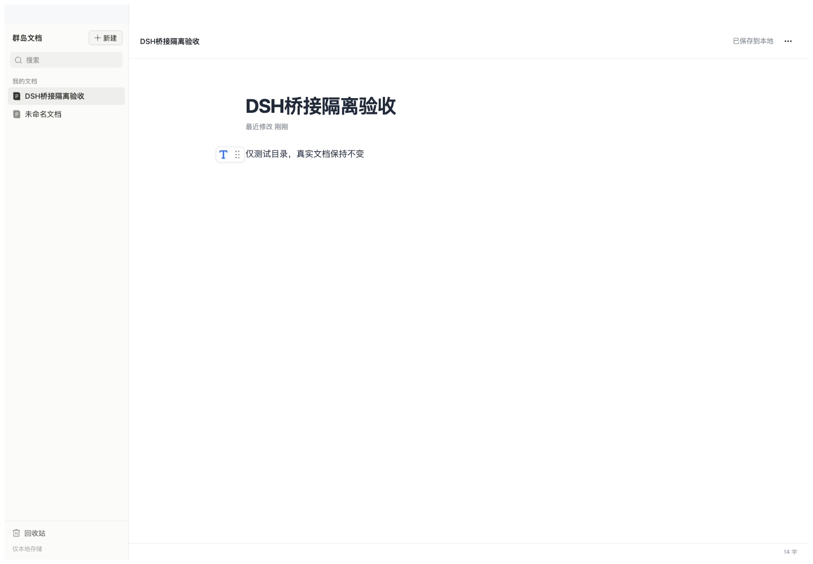

# 群岛文档 · Qundao Docs

按飞书文档交互复刻、**只存本机**的富文本文档编辑器，作为 DeepSeek Harness（DSH）的侧栏面板运行。



## 安装

需要 DeepSeek Harness `>=0.2.2-0 <0.3.0-0`、Node.js 20+。

本仓库是「前端应用源码 + 生成好的插件包」结构，可安装的插件包在 `dsh-host-plugin/`：

```bash
dsh plugin --profile web add github:Yang-unplugged/dsh-qundao-doc#path:/dsh-host-plugin
```

也可以在 DSH 的插件页用「添加本地插件」，选中本仓库的 `dsh-host-plugin/` 目录。
装完重启 `dsh web`，侧栏出现「群岛文档」。

## 能做什么

- **块编辑**：标题 1–9、列表 / 任务列表、引用、分割线、分栏、高亮块（图标、字体色、边框色、填充色分别设置）
- **表格**：9×9 网格选择、键盘选择、自定义行列、合并拆分、单元格垂直对齐、整表移动
- **代码块**：语言搜索、自动检测、换行开关、复制
- **图片与附件**：本地资源库（PNG / JPEG / GIF / WebP，单个 ≤20 MB），SHA-256 校验
- **评论**：选区评论、回复、解决；单段文字替换建议
- **版本**：完整历史、命名版本、恢复、回收站（软删除可恢复）
- **资料库**：整库备份导出、从备份恢复到空目录
- **阅读模式**、目录、字数、标准 / 较宽 / 全宽三档版式

## 数据在哪

默认 `~/.dsh/qundao-doc`（可在插件 config 里用绝对路径改 `dataDir`）。

单文档内容上限 8 MiB、嵌套 64 层、10 万节点。保存时先写临时文件并 fsync，再原子 rename；目录上有一把进程级 `.lock`，防止两个实例同时写同一资料库。

## 已知限制

- 没有云协作、分享权限、真实通知，也不与飞书同步；本地评论不等于完整的修订追踪
- 普通表格 ≠ 电子表格 / 多维表格；本地画板 ≠ 飞书白板
- 未验证：原生鼠标拖拽、中文输入法候选窗、与飞书像素级一致的布局
- 块拖动目前只支持同一父容器内，不支持跨容器
- 资料库按整库序列化，适合中小规模文档库，不是大数据量方案

## 开发

```bash
npm install
npm run build                    # Vite 构建到 dist/
node integration/build-host.mjs  # 由 dist/ 生成 dsh-host-plugin/（产物需一并提交）
npm test                         # 存储与编辑器单元测试
node integration/test-adapter.mjs
node integration/test-request-bridge.mjs
```

`integration/test-host.mjs` 是真实浏览器联调，需要本机 Chrome 与 Playwright。

## 验证记录

- 单元测试 100 项通过
- 宿主适配器、请求桥、样式与编辑器检查通过
- 官方 DSH `0.2.2-rc.1` 隔离宿主上做过加载、路由、增删改查、版本、图片与重启持久化验收

详见 [`docs/CLOUD-QA.md`](docs/CLOUD-QA.md)、[`docs/OFFICIAL-HOST-QA.md`](docs/OFFICIAL-HOST-QA.md)。

## 界面素材

界面图标是按飞书文档截图 / 客户端重建的矢量，不是飞书官方源文件，说明见 [`docs/ICON-SOURCES.md`](docs/ICON-SOURCES.md)。

---

A local-first rich-text document editor for DeepSeek Harness, modelled on Feishu Docs. Documents, comments, revision history and image assets stay on your machine.
